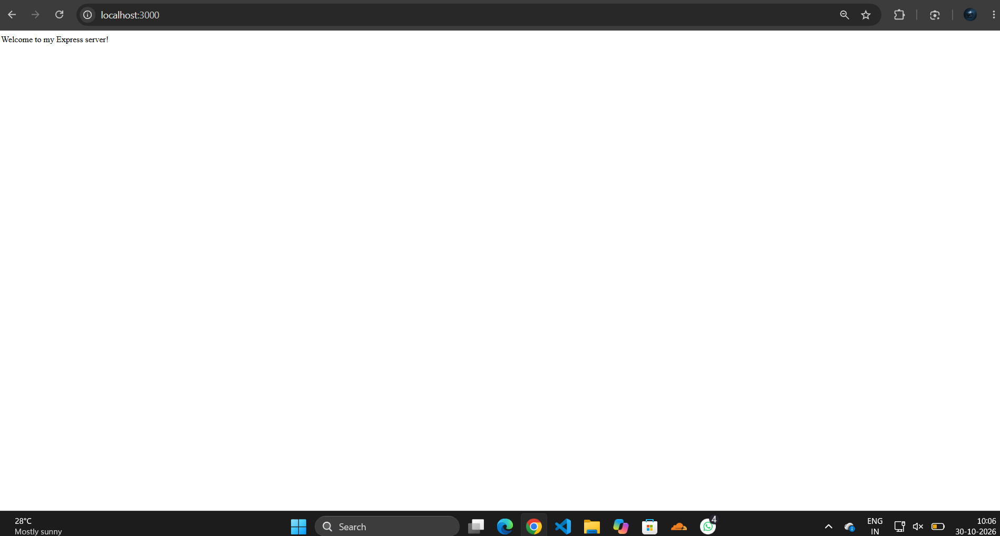
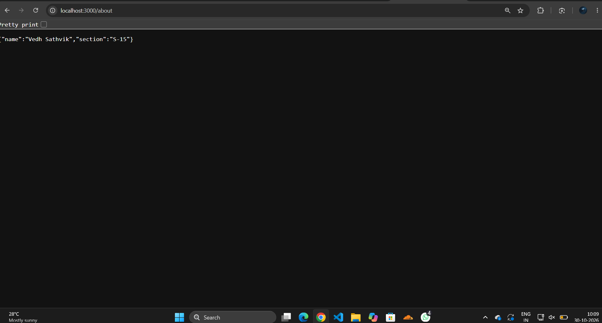
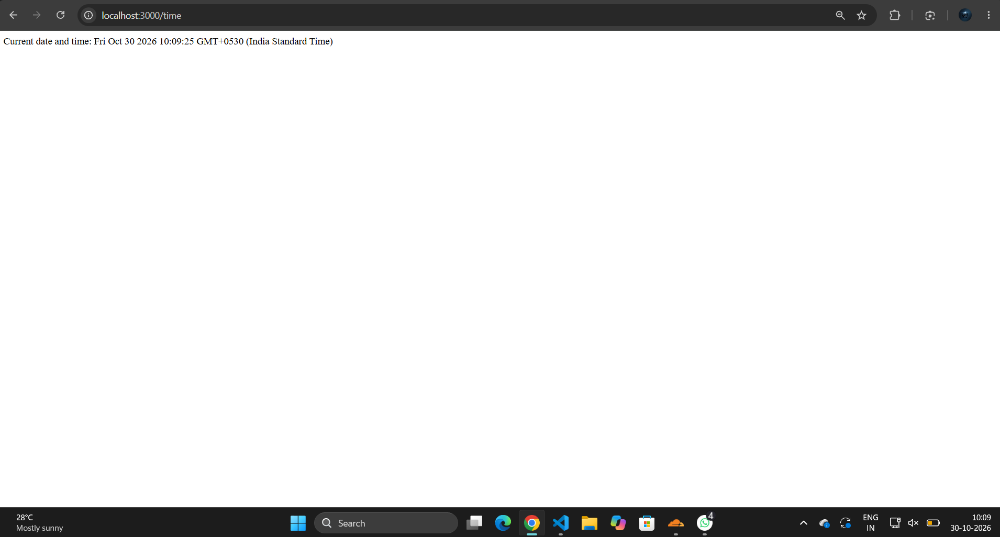
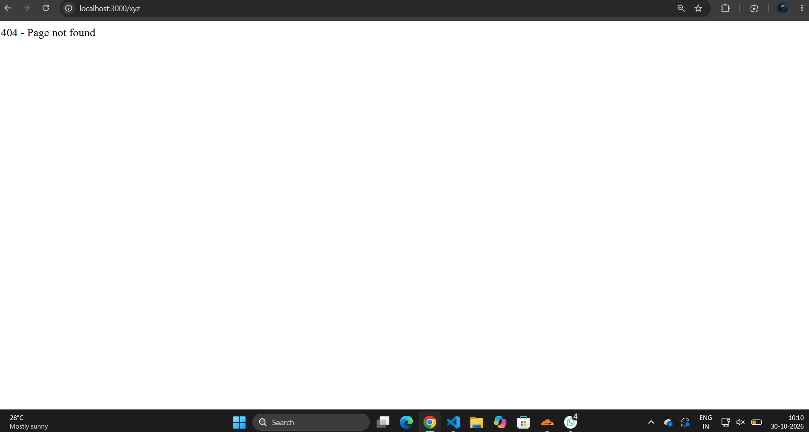

# Lab 1: Node.js and Express server

**Name:** A. Vedh Sathvik · **Registration number:** 252U1R1004 · **Section:** S-15

**Live link:** : https://bdf-lab-1-03o5.onrender.com/

## About
A small Node.js project with two servers: a plain version using the built-in `http` module (`server-http.js`) and an Express version (`server.js`) with three routes, a 404 handler, and a middleware that logs each request's route and status code to the terminal.

## How to run
1. Open the lab folder:
   ```bash
   cd lab-1
   ```
2. Install dependencies:
   ```bash
   npm install
   ```
3. Start the Express server:
   ```bash
   npm start
   ```
4. Open http://localhost:3000/

To run the plain `http` version instead:
```bash
node server-http.js
```

**Environment variables:** none required. (`PORT` is optional and defaults to 3000; Render sets it automatically.)

## Routes

| Method | Path | Response | Status |
| --- | --- | --- | --- |
| GET | `/` | Welcome text | 200 |
| GET | `/about` | JSON with name and section | 200 |
| GET | `/time` | JSON with current date and time | 200 |
| GET | any other path | `404 Not Found` | 404 |

## Screenshots

### GET /


### GET /about


### GET /time


### 404 page


