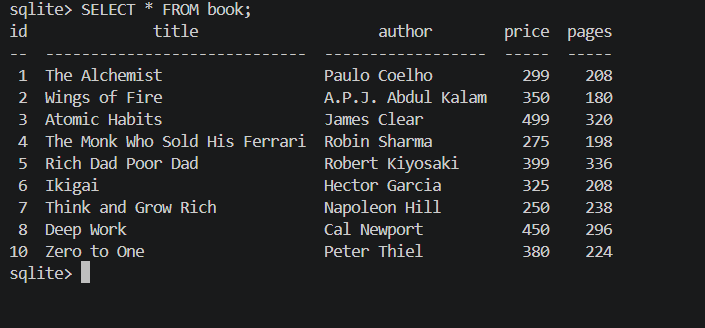
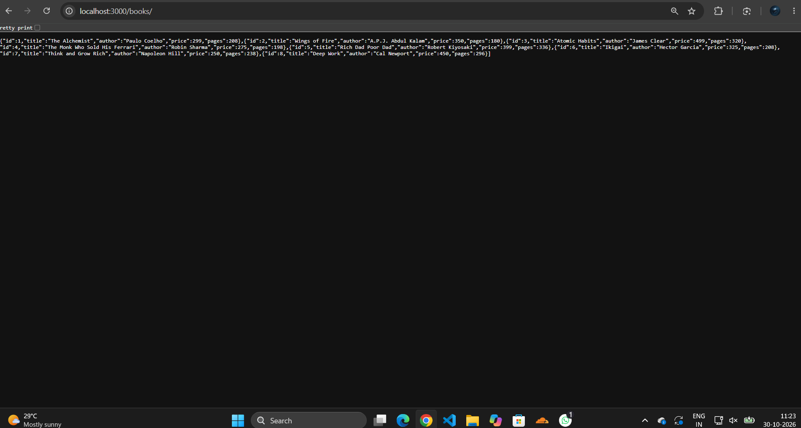
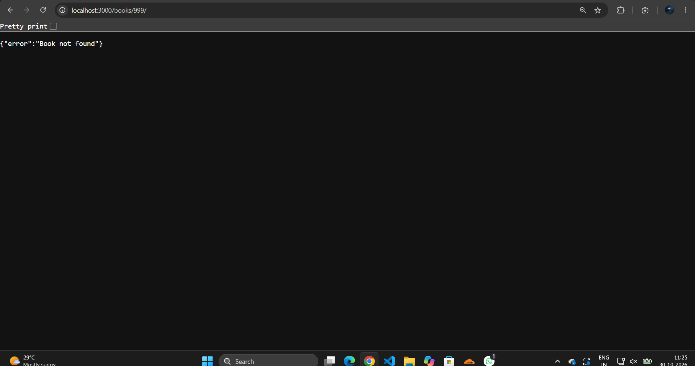
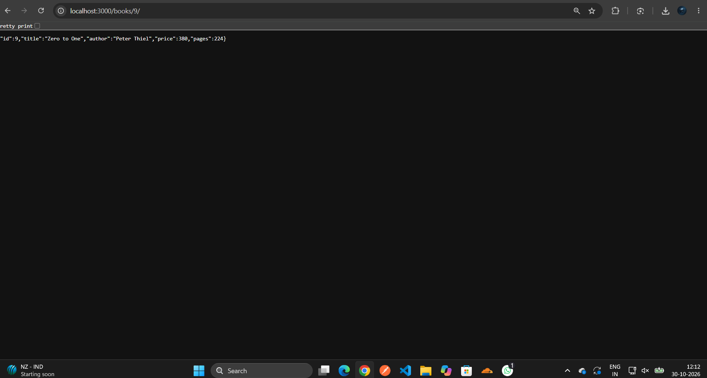
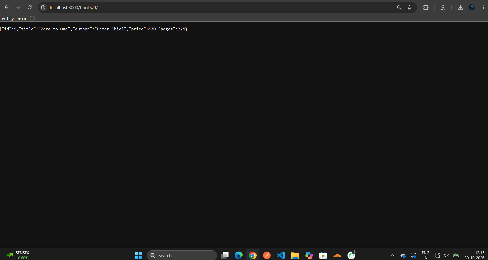
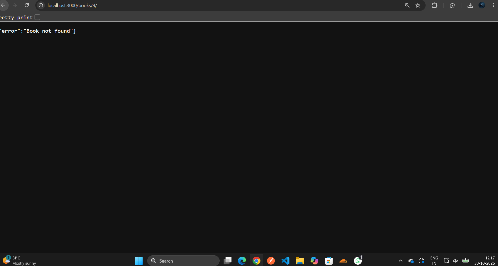
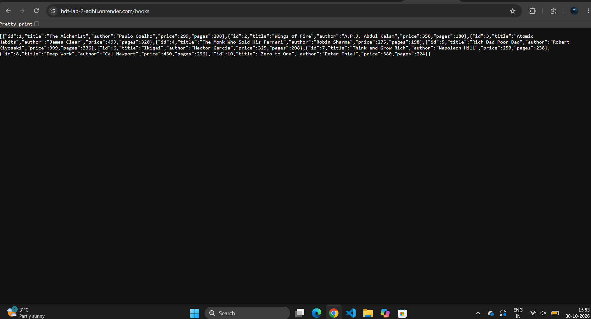

# Lab 2: SQLite database and CRUD routes

**Name:** A. Vedh Sathvik · **Registration number:** 252U1R1004 · **Section:** S-15

**Live link:** https://bdf-lab-2-adh8.onrender.com/books/

## About
An Express server connected to a SQLite database (`books.db`) that exposes CRUD operations for a `book` table: `book(id, title, author, price, pages)`. All queries use `?` placeholders to prevent SQL injection.

## How to run
1. Clone the repository and open the lab folder:
   ```bash
   cd lab-2
   ```
2. Install dependencies:
   ```bash
   npm install
   ```
3. Start the server:
   ```bash
   npm start          # normal start
   npm run dev        # auto-restart with nodemon
   ```
4. Open http://localhost:3000/books/

**Environment variables:** none required. (`PORT` is optional and defaults to 3000; Render sets it automatically.)

## Endpoints

| Method | Path | Description |
| --- | --- | --- |
| GET | `/` | Health message showing the API is running |
| GET | `/books/` | Get all books |
| GET | `/books/:bookId/` | Get one book by id (404 if not found) |
| POST | `/books/` | Add a new book (201, returns new `bookId`) |
| PUT | `/books/:bookId/` | Update a book (404 if not found) |
| DELETE | `/books/:bookId/` | Delete a book (404 if not found) |

Request body for POST and PUT (JSON):
```json
{ "title": "Zero to One", "author": "Peter Thiel", "price": 380, "pages": 224 }
```

## Screenshots

### SQLite CLI: table and initial rows


### GET all books


### GET book not found (404)


### POST add a book (201)


### PUT update a book (200)


### DELETE a book (200)


### Live deployment on Render
