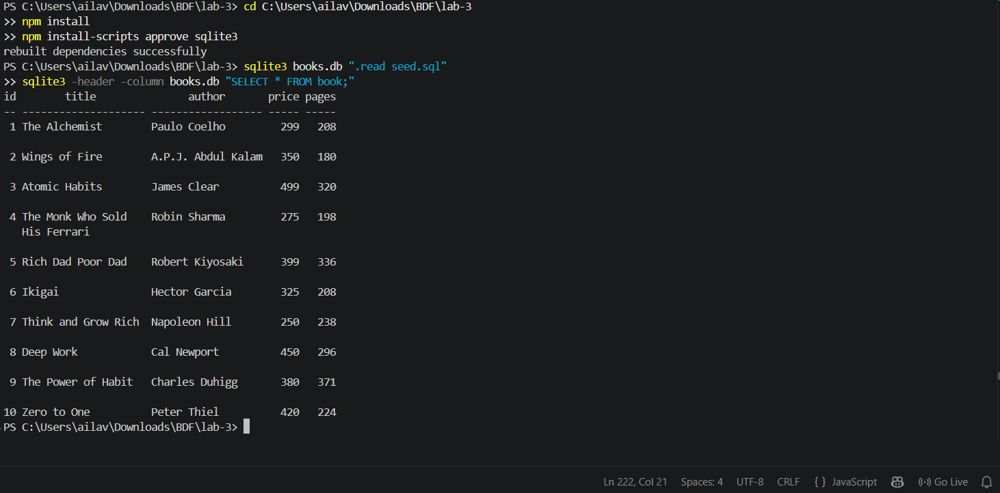
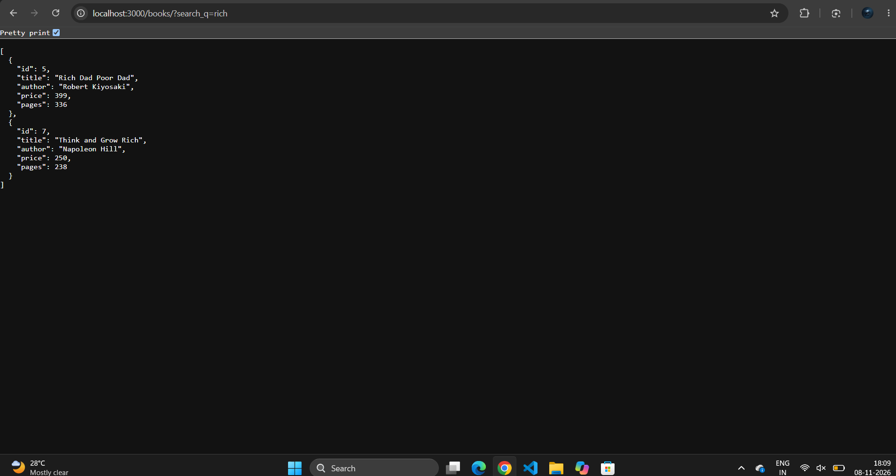
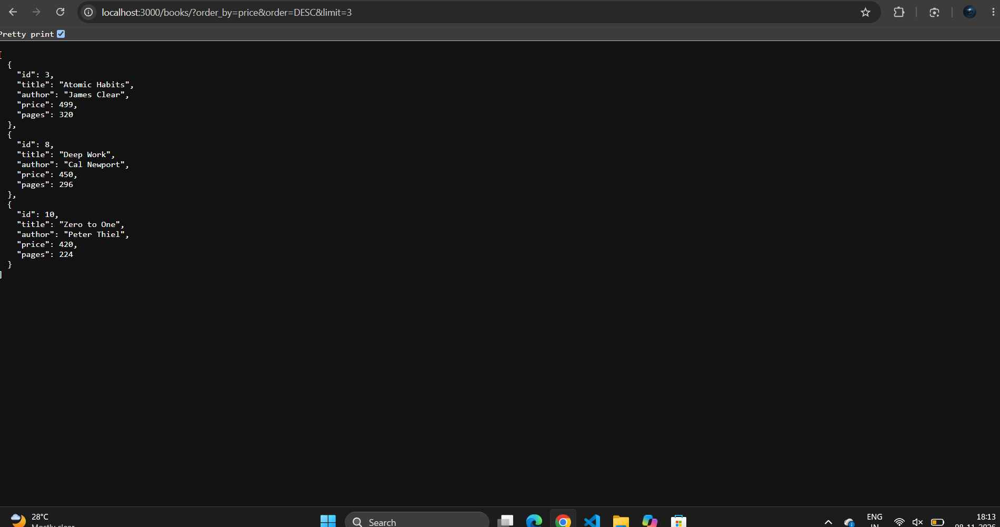
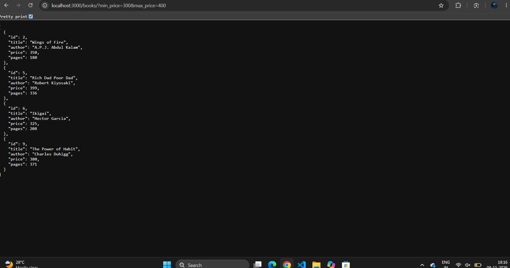
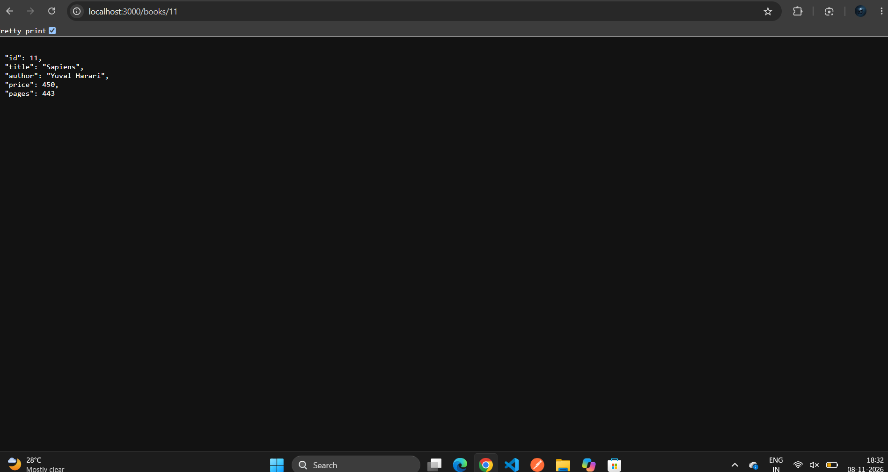
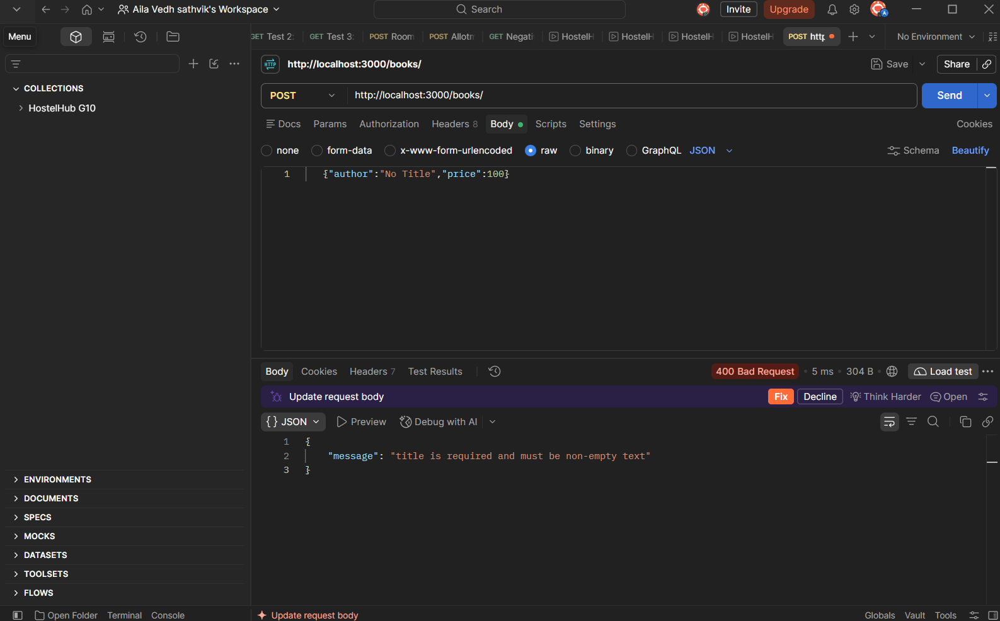
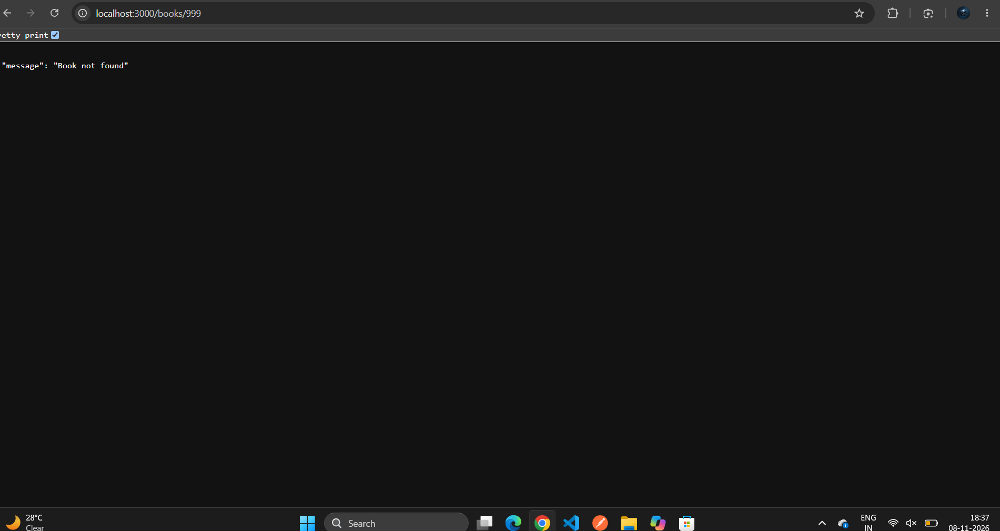

# Lab 3: REST API, query parameters, validation, debugging

**Name:** A. Vedh Sathvik · **Registration number:** 252U1R1004 · **Section:** S-15

**Live link:** https://<your-url>/books/

## About
The Lab 2 book API turned into a clean REST API with search, sorting, paging, a price filter, request validation, correct status codes and one consistent JSON format. All queries use `?` placeholders.

## How to run
1. `cd lab-3`
2. `npm install`
3. Create the database: `sqlite3 books.db ".read seed.sql"`
4. `npm start` (or `npm run dev` for auto-restart)
5. Open http://localhost:3000/books/

No environment variables are required (`PORT` defaults to 3000).

## Endpoints

| Method | Path | Description | Success | Errors |
| --- | --- | --- | --- | --- |
| GET | `/books/` | List books with search, sort, filter and paging | 200 | 400 |
| GET | `/books/:bookId/` | One book | 200 | 400, 404 |
| POST | `/books/` | Create a book | 201 | 400 |
| PUT | `/books/:bookId/` | Update a book | 200 | 400, 404 |
| DELETE | `/books/:bookId/` | Delete a book | 200 | 400, 404 |

## Query parameters for GET /books/

| Parameter | Meaning | Default |
| --- | --- | --- |
| `search_q` | Partial title match (`LIKE`) | empty (all books) |
| `order_by` | `id`, `title`, `author`, `price` or `pages` | `id` |
| `order` | `ASC` or `DESC` | `ASC` |
| `limit` | Number of rows to return | 10 |
| `offset` | Rows to skip | 0 |
| `min_price` | Lowest price to include | none |
| `max_price` | Highest price to include | none |

Example: `/books/?search_q=the&min_price=250&max_price=400&order_by=price&order=DESC&limit=5`

## Validation and response format
- POST and PUT need a non-empty `title`, a non-empty `author` and a numeric `price` of 0 or more. `pages` is optional but must be a whole number.
- Invalid input returns **400**. A valid id that does not exist returns **404**.
- Every error and message is JSON: `{ "message": "..." }`.

## Screenshots

### Database rows

### Search

### Sort

### Price range

### Create book (201)

### Validation error (400)

### Not found (404)

## Postman
Import `postman/Lab3.postman_collection.json`. It has 20 requests covering success, not-found and bad-input cases. Reset the database (`sqlite3 books.db ".read seed.sql"`) before each run.

## Notes
- `order_by` is checked against a fixed list, because a column name cannot be a `?` placeholder.
- A browser can only send GET requests, so POST, PUT and DELETE are tested in Postman, and the result is then checked with a GET in the browser.
- Debugging practised: port conflict (EADDRINUSE), wrong import path, table-name typo, and a missing `await`.
- **Deployment:** hosted on Render's free plan. The filesystem resets on restart, redeploy or sleep, so books created on the live site disappear and the database returns to the committed `books.db` (10 books). The first request after a sleep can take up to a minute.